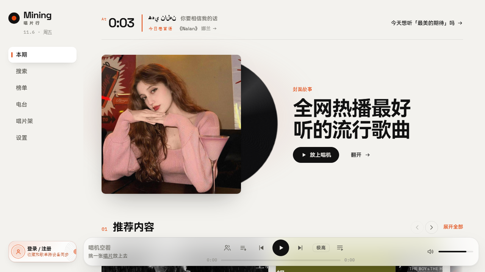

<p align="center">
  
</p>

<h1 align="center">Mining 唱片行</h1>

<p align="center">把音乐放上唱机。一个杂志风格的音乐播放器，连接你的歌单、好友与日常。</p>

<p align="center">
  <a href="https://echo.miningqwq.cn">在线体验</a> ·
  <a href="https://echo.miningqwq.cn/#/download">客户端下载</a> ·
  <a href="docs/README.md">项目文档</a> ·
  <a href="https://github.com/guangtw/miningqwqmusic/issues/new/choose">反馈问题</a>
</p>

<p align="center">
  <a href="https://github.com/guangtw/miningqwqmusic/actions/workflows/ci.yml"></a>
  
  
  
</p>



## 关于项目

Mining 唱片行使用 Next.js、React 和 TypeScript 构建，前端沿用 [唱片行](https://github.com/guangtw/chang-pian-hang) 的杂志排版、黑胶唱机与视图过渡设计，在此基础上加入账户同步、社交和客户端能力。网页与 BFF 同源运行，音乐服务和账户服务通过服务端配置接入。

### 可以做什么

- **发现与收听**：歌曲、歌单、专辑和歌手搜索，榜单、电台、同步歌词与播放队列。
- **整理音乐库**：收藏、最近播放、自建与导入歌单，以及登录后的云端同步。
- **和朋友听歌**：好友、私信、音乐卡片、歌单分享与一起听。
- **管理账户**：昵称与头像、邮箱辅助登录、密码及邮箱验证码改密。
- **跨设备使用**：响应式网页、可安装的 PWA，以及 Windows 和 Android 客户端。

音乐、封面与可用音质来自所配置的上游服务，实际播放能力取决于音源和账户权限。PWA 提供离线提示页，不缓存歌曲供离线收听。

## 使用与下载

| 平台 | 入口 | 说明 |
| --- | --- | --- |
| Web | [打开唱片行](https://echo.miningqwq.cn) | 浏览器直接使用，也可安装为 PWA |
| Windows | [下载安装包](https://echo.miningqwq.cn/api/downloads/windows) | x64 EXE 安装版，需 WebView2 Runtime；[客户端说明](desktop/windows/README.md) |
| Android | [下载 APK](https://echo.miningqwq.cn/api/downloads/android) | 在线加载站点；[客户端说明](desktop/android/README.md) |

版本和校验信息可在[客户端下载页](https://echo.miningqwq.cn/#/download)查看。GitHub 中的 `windows-*`、`android-*` Release 对应客户端，`echo-*` Release 是网站与账户服务的源码发布包。

## 本地开发

开发环境使用 Node.js 24 与 npm。先克隆仓库并安装锁定的依赖：

```bash
git clone https://github.com/guangtw/miningqwqmusic.git
cd miningqwqmusic
npm ci
cp .env.example .env.local
```

不接入真实服务时，在 `.env.local` 中设置：

```dotenv
MUSIC_SOURCE_MOCK_ENABLED=true
MUSIC_SOURCE_MOCK_FALLBACK=false
ACCOUNT_SERVICE_BASE_URL=
```

```bash
npm run dev -- --hostname 127.0.0.1 --port 3010
```

打开 [localhost:3010](http://localhost:3010)。Mock 模式用于界面开发，不提供真实账号和完整线上音源能力。详细说明见[开发指南](docs/development.md)。

### 接入真实服务

| 配置 | 用途 |
| --- | --- |
| `MUSIC_SOURCE_BASE_URL` | 网易云 API 风格的音乐服务地址 |
| `MUSIC_SOURCE_API_KEY` | 上游要求的密钥，可为空；仅服务端使用 |
| `MUSIC_SOURCE_MOCK_ENABLED` | 接真实服务时设为 `false` |
| `ACCOUNT_SERVICE_BASE_URL` | 可选的独立[账户服务](https://github.com/guangtw/miningqwqlogin)地址 |

全部配置见 [`.env.example`](.env.example)，上游协议见[接口约定](docs/upstream-contract.md)。生产环境需要自行配置服务、数据库和 HTTPS；本仓库的自动发布入口依赖维护者的部署环境。

## 代码结构

```text
app/                 Next.js 页面与同源 API
src/frontend/        React 界面、播放器与浏览器状态
src/lib/music/       音源适配、请求调度与服务层
src/types/           共享类型
public/              PWA、图标与静态资源
desktop/             Windows / Android 客户端
tests/               单元、集成与浏览器测试
docs/                开发、功能协议与维护文档
ops/                 部署、备份与服务器配置
```

独立账户服务使用 Next.js、Prisma 和 SQLite，在 [miningqwqlogin](https://github.com/guangtw/miningqwqlogin) 中维护，不包含在本仓库运行进程内。

## 验证与贡献

```bash
npx tsc --noEmit
npm run test:run
npm run build
npm run test:e2e
```

Web CI 自动执行类型检查、单元与集成测试和生产构建；浏览器测试及客户端构建有各自的环境要求，见[开发指南](docs/development.md)。

欢迎通过 [Issue](https://github.com/guangtw/miningqwqmusic/issues/new/choose) 描述问题或建议，也可以提交范围清晰的 Pull Request。开始前请阅读[贡献指南](CONTRIBUTING.md)。安全问题请使用[私密报告渠道](SECURITY.md)。

## 文档

- [开发与本地配置](docs/development.md)
- [文档导航：功能协议、客户端与维护](docs/README.md)
- [一起听](docs/listen-together.md) · [私信与分享](docs/social-and-messages.md) · [客户端下载](docs/client-downloads.md)

## 来源与许可证

前端设计与基础实现来自 [guangtw/chang-pian-hang](https://github.com/guangtw/chang-pian-hang)，后续功能在本仓库继续维护。第三方依赖、字体与上游媒体保留各自的权利和许可说明。

本仓库目前未指定开源许可证，因此不展示 MIT、Apache 等许可证标识。
